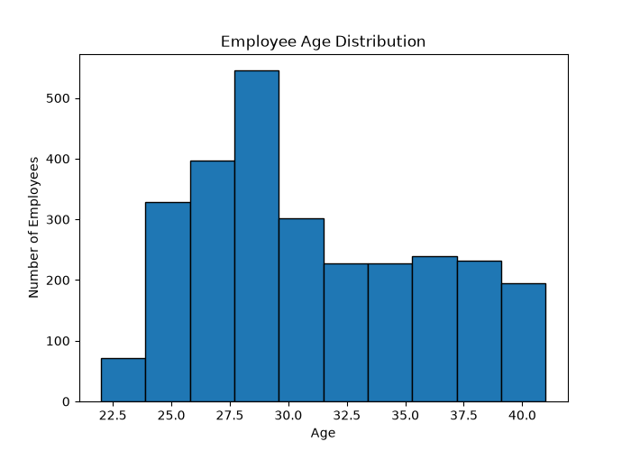
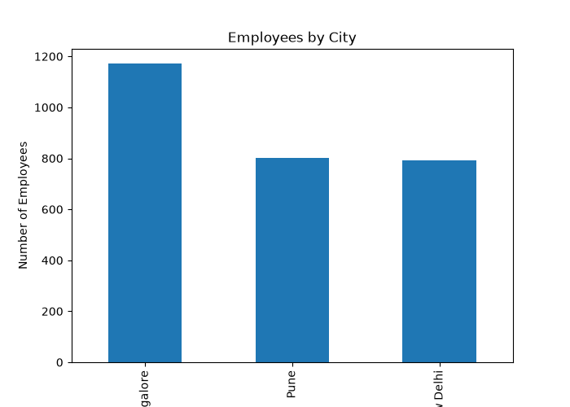
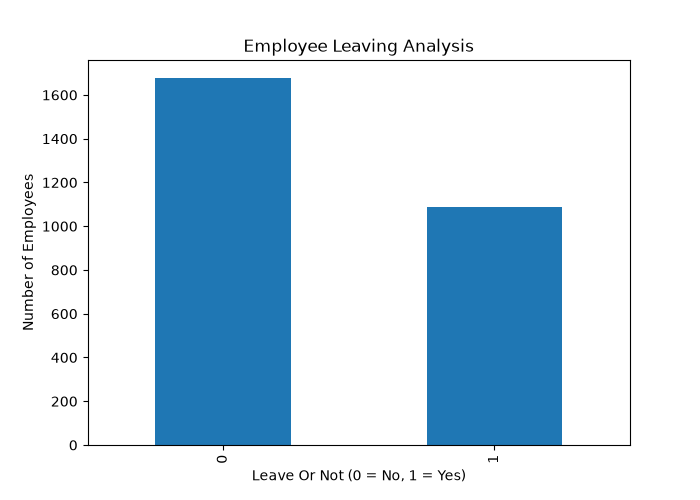

# Employee Data Analysis using Python

## Project Overview
This project focuses on analyzing employee data using Python. It uses Pandas for data cleaning and analysis and Matplotlib for data visualization.

## Technologies Used
- Python
- Pandas
- Matplotlib

## Dataset Information
- Total original records: 4,653
- Total columns: 9
- Duplicate records: 1,889
- Records after removing duplicates: 2,764

## Project Objectives
1. Load the employee dataset.
2. Clean the dataset by removing duplicate records.
3. Identify missing values.
4. Calculate average and maximum values.
5. Generate graphs for data visualization.
6. Summarize the analysis results.

## Data Analysis Results

| Analysis | Result |
|---|---:|
| Total Employees after Cleaning | 2,764 |
| Total Columns | 9 |
| Average Age | 30.95 |
| Maximum Age | 41 |
| Average Experience | 2.64 |
| Maximum Experience | 7 |
| Most Common City | Bangalore |
| Employees Who Left | 1,088 |
| Employees Who Stayed | 1,676 |
| Missing Values | 0 |

## Visualizations

### 1. Employee Age Distribution


### 2. Employees by City


### 3. Employee Leaving Analysis


## Project Files
- `app.py` – Python source code.
- `Employee.csv` – Original dataset.
- `cleaned_employee.csv` – Cleaned dataset.
- `age_distribution.png` – Age distribution graph.
- `city_distribution.png` – City distribution graph.
- `employee_leaving.png` – Employee leaving analysis graph.

## How to Run the Project

### Step 1: Install Required Libraries

```bash
pip install pandas matplotlib
```

### Step 2: Run the Python File

```bash
python app.py
```

## Conclusion
This project successfully analyzes employee data using Python, Pandas, and Matplotlib. The analysis identifies employee age and experience statistics, city distribution, and employee leaving patterns. Three visualizations were created to understand the dataset more clearly.

## Author
Santhoshini

